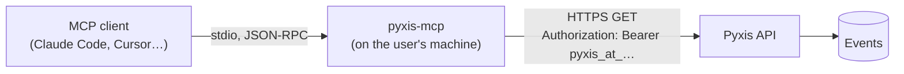

<div align="center">

<picture>
  <source media="(prefers-color-scheme: dark)" srcset="https://raw.githubusercontent.com/samuelcsantana/pyxis-mcp/main/.github/assets/cover-dark.png">
  
</picture>

**The MCP server of Pyxis: lets an AI agent read your dashboard's numbers, with a read-only token
you can revoke at any time.**

[](https://github.com/samuelcsantana/pyxis-mcp/actions/workflows/ci.yml)
[](https://github.com/samuelcsantana/pyxis-mcp/actions/workflows/codeql.yml)
<br>
[](LICENSE)
[](tsconfig.json)
[](https://www.conventionalcommits.org)

**[Pyxis](https://pyxis-analytics.dev)** · **[Live demo](https://demo.pyxis-analytics.dev)** ·
**[API reference](https://samuelcsantana.github.io/pyxis-api/)**

</div>

> **Status:** early development. This repository holds the skeleton and the configuration
> reader; the tools and the first version on npm come next (see [Roadmap](#roadmap)).

## Ecosystem

| Repository                                               | Role                                                          |
| -------------------------------------------------------- | ------------------------------------------------------------- |
| [pyxis-api](https://github.com/samuelcsantana/pyxis-api) | Ingestion, dashboard sign-in and queries, erasure, retention  |
| [pyxis-sdk](https://github.com/samuelcsantana/pyxis-sdk) | Browser tracker published to npm as `pyxis-analytics`         |
| [pyxis-web](https://github.com/samuelcsantana/pyxis-web) | The dashboard: overview, funnels, features, requests          |
| **pyxis-mcp** (this one)                                 | MCP server that lets an AI agent read the dashboard's numbers |

## Why it exists

More and more questions about a product are asked to an agent instead of a dashboard: "how did
last week compare", "where does the sign-up funnel lose people", "which route started failing".
This server gives Claude Code, Claude Desktop, Cursor and other MCP clients the same numbers the
Pyxis dashboard shows, and nothing more: it uses an access token that only reads, created by an
admin in the dashboard's Settings and revocable there at any moment. Like the rest of Pyxis, there
is no personal data to hand over: events carry no cookies, no addresses and no user agents.

## Planned tools

One read-only tool per dashboard screen, each a thin call to the matching `GET` route of the API:
`list_projects`, `overview`, `visits`, `visit_timeline`, `funnel`, `features`, `requests`,
`acquisition`, `devices` and `engagement`.

## Configuration

| Variable        | Required | Meaning                                                                                                           |
| --------------- | -------- | ----------------------------------------------------------------------------------------------------------------- |
| `PYXIS_TOKEN`   | yes      | A read-only access token (`pyxis_at_` and 32 letters and digits), created in the dashboard under Settings         |
| `PYXIS_API_URL` | no       | The Pyxis API to read, as an origin. Defaults to `https://api.pyxis-analytics.dev`; plain http only for localhost |

A missing or malformed value stops the server with a sentence that names the variable and never
repeats its value.

## Architecture



The server opens no port and keeps no state. The API decides what the token may read, exactly as
it does for a dashboard session ([ADR 0002](docs/adr/0002-local-read-only-server.md)).

## Tech stack

TypeScript (strict) on Node 22 or later, ES modules. Vitest with V8 coverage, ESLint
(`typescript-eslint` strict, type-checked) and Prettier, Husky and commitlint, GitHub Actions with
CodeQL, Dependabot and release-please.

## Getting started

```bash
npm ci
npm run lint && npm run typecheck && npm run test:cov && npm run build
```

## Testing

- `npm run test:cov` runs the unit tests in Node and fails below **100%** of statements, branches,
  functions and lines. Nothing is excluded from coverage besides the test files themselves.
- `npm run test:tooling` tests the lint rule and the comment check.
- CI runs the tests on Node 24 and again on Node 22, the oldest version the package supports.

## Project structure

```
src/            configuration and, next, the server and its tools
eslint-rules/   the local rule that forbids comments
scripts/        the comment check for YAML, shell and config files
docs/adr/       architecture decision records
```

## Privacy and security

- Read-only: the API accepts the token only on its read routes; it cannot write, sign in, manage
  sessions or create tokens.
- The token only travels in the `Authorization` header to the configured API, over https (plain
  http only to localhost), and never reaches a log, an error message or a tool result.
- Text written by a site's visitors is returned as data, and each tool description says it is not
  an instruction.
- Vulnerabilities: see [SECURITY.md](SECURITY.md).

## Architecture decisions

| ADR                                                    | Decision                                                     |
| ------------------------------------------------------ | ------------------------------------------------------------ |
| [0001](docs/adr/0001-record-architecture-decisions.md) | Record architecture decisions                                |
| [0002](docs/adr/0002-local-read-only-server.md)        | A local, read-only server that uses the admin's access token |

## Roadmap

- [x] Repository skeleton, quality gates, configuration reader
- [ ] Tools over the API's read routes, tested against its OpenAPI contract
- [ ] First release on npm, with provenance
- [ ] Setup guides for Claude Code, Claude Desktop and Cursor

## Contributing and license

See [CONTRIBUTING.md](CONTRIBUTING.md) and the [Code of Conduct](CODE_OF_CONDUCT.md). MIT licensed:
see [LICENSE](LICENSE).
