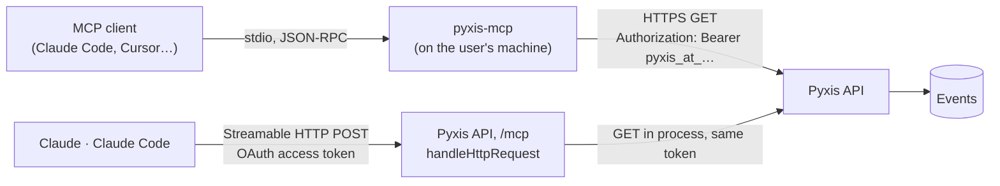

<div align="center">

<picture>
  <source media="(prefers-color-scheme: dark)" srcset="https://raw.githubusercontent.com/samuelcsantana/pyxis-mcp/main/.github/assets/cover-dark.png">
  
</picture>

**The MCP server of Pyxis: lets Claude and other AI agents read your dashboard's numbers, only
reading, through a connection or a token you can revoke at any time.**

[](https://github.com/samuelcsantana/pyxis-mcp/actions/workflows/ci.yml)
[](https://codecov.io/gh/samuelcsantana/pyxis-mcp)
[](https://github.com/samuelcsantana/pyxis-mcp/actions/workflows/codeql.yml)
[](https://scorecard.dev/viewer/?uri=github.com/samuelcsantana/pyxis-mcp)
<br>
[](LICENSE)
[](tsconfig.json)
[](https://www.conventionalcommits.org)
[](https://www.npmjs.com/package/pyxis-mcp)
[](https://www.npmjs.com/package/pyxis-mcp#provenance)

**[Pyxis](https://pyxis-analytics.dev)** · **[Live demo](https://demo.pyxis-analytics.dev)** ·
**[API reference](https://samuelcsantana.github.io/pyxis-api/)**

</div>

> **Status:** on npm as `pyxis-mcp`, every release published from GitHub Actions with
> provenance. The sixteen tools read the live Pyxis API. The package also exports them as a
> library, and the Pyxis API serves them at `https://api.pyxis-analytics.dev/mcp`, the remote
> connector that Claude and Claude Code sign in to with OAuth.

## Ecosystem

| Repository                                               | Role                                                                                   |
| -------------------------------------------------------- | -------------------------------------------------------------------------------------- |
| [pyxis-api](https://github.com/samuelcsantana/pyxis-api) | Ingestion, sign-in, dashboard queries, accounts and billing, erasure, the MCP endpoint |
| [pyxis-sdk](https://github.com/samuelcsantana/pyxis-sdk) | Browser tracker published to npm as `pyxis-analytics`                                  |
| [pyxis-web](https://github.com/samuelcsantana/pyxis-web) | The dashboard and the home page                                                        |
| **pyxis-mcp** (this one)                                 | MCP server: Claude and other agents read the dashboard's numbers                       |

## Why it exists

More and more questions about a product are asked to an agent instead of a dashboard: "how did
last week compare", "where does the sign-up funnel lose people", "which route started failing".
This server gives Claude Code, Claude Desktop, Cursor and other MCP clients the same numbers the
Pyxis dashboard shows, and nothing more: it reads through a Claude connection the admin allows or
an access token the admin creates, both read-only and revocable in the dashboard's Settings at any
moment. Like the rest of Pyxis, there
is no personal data to hand over: events carry no cookies, no addresses and no user agents.

## Tools

Every tool only reads, and maps to one `GET` route of the Pyxis API. Dates are `YYYY-MM-DD` in the
project's time zone; `list_projects` gives each project's today, so call it first. The server's
instructions tell the agent what an empty account means: with no project, one is created in the
dashboard; with a project that has received no event, the site does not run the tracker yet, and
[llms.txt](https://pyxis-analytics.dev/llms.txt) explains how to install it.

| Tool               | What it answers                                                                                           |
| ------------------ | --------------------------------------------------------------------------------------------------------- |
| `list_projects`    | The projects the token can read: id, name, time zone, today there, conversion event, first and last event |
| `overview`         | Visits, identified users, conversions and failed writes against the previous period; top pages and events |
| `devices`          | Visits and conversions by device type, browser, system, country and region                                |
| `acquisition`      | Visits per day and channel, and the sources and campaigns behind them                                     |
| `engagement`       | Entry and exit pages, single-page visits, visit length                                                    |
| `time_of_day`      | Visits by weekday and local hour                                                                          |
| `features`         | The most used named events or screens, day by day                                                         |
| `event_properties` | How the property values of one named event break down                                                     |
| `property_summary` | The median and quartiles of a numeric property, split by another: how long people read each article       |
| `requests`         | Calls to the site's backend per route: failures, statuses, durations, latest errors                       |
| `funnel`           | How many visits or people reached each step, and the time between steps                                   |
| `funnel_segments`  | The same funnel per device type or channel                                                                |
| `funnel_subjects`  | The visits or people who reached, or dropped at, one step                                                 |
| `visits`           | The visits of a range, filtered by pages, events, channel, device, country, campaign, failed requests     |
| `visit_timeline`   | Every event of one visit, or every visit of one identified person                                         |
| `project_settings` | Time zone, conversion event, allowed origins, retention, live public keys                                 |

A result is JSON text, `{ "untrusted_visitor_text": "…", "report": … }`: the report is the API's
answer, and the first field reminds the agent that names, paths and values inside it were written by
the site's visitors. Times come in the project's time zone, with the offset of each moment
(`2026-10-13T22:41:41.638-03:00`), where the API answers in UTC; the timeline's `before` takes any
offset ([ADR 0004](docs/adr/0004-times-in-the-project-time-zone.md)). Problems come back as tool errors the agent can act on (a revoked token, an
unknown project, the rate limit and when to retry). When the API refuses a request (any `4xx`), the
error carries the API's own code and reason, such as a suspended account; only a `5xx` asks to try
again later.

## Connect from Claude

The hosted Pyxis serves these tools at **`https://api.pyxis-analytics.dev/mcp`**. Claude connects
to it with no token and nothing to install: you sign in to Pyxis once and allow the connection.

**Claude** (on the web, the desktop app and the phone):

1. In Claude, open Settings, then Connectors, and choose **Add custom connector**. In some versions
   the menu is Customize, then Connectors.
2. Name it `Pyxis` and paste `https://api.pyxis-analytics.dev/mcp`. Leave the advanced OAuth fields
   empty.
3. Choose **Connect**. A Pyxis page opens: sign in with the code sent to your e-mail, check the
   app, where its data goes and your projects, and choose **Allow**.

**Claude Code:**

```bash
claude mcp add --transport http pyxis https://api.pyxis-analytics.dev/mcp
```

Then run `/mcp` in Claude Code, pick `pyxis` and choose **Authenticate**: the same Pyxis page
opens in the browser.

A connection only reads the numbers you see in the dashboard, from every project you can open. It
renews itself while it is used (each access token lasts an hour) and ends when you revoke it in the
dashboard, under Settings, Connected apps, or after 90 days without use; you keep up to ten. The
data Claude asks for goes from the Pyxis API to Anthropic, which handles it under its own terms.
Only Claude and Claude Code connect this way; other clients use an access token.

## Connect from other clients

A client that sends a header reaches the same address with an access token instead of signing in.
Create one in the dashboard (Settings, Access tokens), choose how long it lives, and revoke it there
when it is no longer needed. It reads the same projects as its admin, and only reads.

Cursor (`~/.cursor/mcp.json`), with the token in the `PYXIS_TOKEN` environment variable:

```json
{
  "mcpServers": {
    "pyxis": {
      "url": "https://api.pyxis-analytics.dev/mcp",
      "headers": { "Authorization": "Bearer ${env:PYXIS_TOKEN}" }
    }
  }
}
```

VS Code (`mcp.json`), which asks for the token once and keeps it out of the file:

```json
{
  "inputs": [
    {
      "type": "promptString",
      "id": "pyxis-token",
      "description": "Pyxis access token",
      "password": true
    }
  ],
  "servers": {
    "pyxis": {
      "type": "http",
      "url": "https://api.pyxis-analytics.dev/mcp",
      "headers": { "Authorization": "Bearer ${input:pyxis-token}" }
    }
  }
}
```

Claude Code, with a token instead of signing in:

```bash
claude mcp add --transport http pyxis https://api.pyxis-analytics.dev/mcp --header "Authorization: Bearer pyxis_at_…"
```

A client that only runs servers on the computer uses the package with the same token (see
[Run it on your computer](#run-it-on-your-computer)). ChatGPT cannot connect yet: its connectors
sign in only with OAuth and cannot send an access token, and the Pyxis OAuth server knows only
Claude and Claude Code.

## Configuration

| Variable        | Required | Meaning                                                                                                           |
| --------------- | -------- | ----------------------------------------------------------------------------------------------------------------- |
| `PYXIS_TOKEN`   | yes      | A read-only access token (`pyxis_at_` and 32 letters and digits), created in the dashboard under Settings         |
| `PYXIS_API_URL` | no       | The Pyxis API to read, as an origin. Defaults to `https://api.pyxis-analytics.dev`; plain http only for localhost |

A missing or malformed value stops the server with a sentence on standard error that names the
variable and never repeats its value.

## Run it on your computer

To run the tools on your own computer, or against a self-hosted Pyxis, create a token in the
dashboard (Settings, Access tokens), then add the server to your client. It runs with `npx`, so
there is nothing to install beforehand (Node 22 or later).

Claude Code:

```bash
claude mcp add pyxis -e PYXIS_TOKEN=pyxis_at_… -- npx -y pyxis-mcp
```

Claude Desktop (`claude_desktop_config.json`) and Cursor (`.cursor/mcp.json`):

```json
{
  "mcpServers": {
    "pyxis": {
      "command": "npx",
      "args": ["-y", "pyxis-mcp"],
      "env": { "PYXIS_TOKEN": "pyxis_at_…" }
    }
  }
}
```

A self-hosted Pyxis adds `PYXIS_API_URL`. To run it from source instead, `npm ci && npm run build`
in a clone and use `node /path/to/pyxis-mcp/dist/cli.js` as the command. Keep the token out of
shared files and chats; revoke it in the dashboard the moment it leaks.

## Use it as a library

Clients that only accept remote servers need the tools at a URL. The package exports them so a
host can serve them from its own endpoint, over Streamable HTTP, with the token of whoever is
calling. It is an ES module that a CommonJS host can also `require()` (Node 22.12 or later).

```ts
import { handleHttpRequest, PyxisApi } from 'pyxis-mcp';

export function answerMcp(request: Request, callerToken: string): Promise<Response> {
  const api = new PyxisApi({
    token: callerToken,
    apiUrl: 'https://api.pyxis-analytics.dev',
    problemTexts: {
      refusedToken: 'Pyxis refused this connection: connect Pyxis again in your MCP client.',
      unreachableAdvice: 'Try again in a moment.',
    },
  });
  return handleHttpRequest(request, api);
}
```

| Export                                      | What it does                                                          |
| ------------------------------------------- | --------------------------------------------------------------------- |
| `handleHttpRequest(request, api, options?)` | Answers one MCP exchange: a web `Request` in, a web `Response` out    |
| `createServer(api, options?)`               | The MCP server with the sixteen tools, for a transport of your choice |
| `new PyxisApi(options)`                     | The client the tools read through, one per caller                     |

`PyxisApi` options: `token` and `apiUrl` (required); `userAgent` (default `pyxis-mcp/<version>`);
`fetch` (default the global one; a host can pass one that answers inside its own process);
`timeoutMs` (default 15 seconds); `problemTexts`, the two sentences that depend on where the server
runs: `refusedToken` and `unreachableAdvice` (default: the local server's, which name
`PYXIS_TOKEN` and `PYXIS_API_URL`). `createServer` takes `version` (default the package's) and
`now` (the clock); `handleHttpRequest` takes those and `allowedOrigins`.

What the handler does: each request gets a server and a transport of its own, closed once it is
answered, so there is no session id and no event stream, only JSON answers. It answers `405` with
`Allow: POST` to any other method, `403` to a request with an `Origin` header unless that origin is
in `allowedOrigins` (none by default: MCP clients do not call from web pages), and `413` to a body
over 64 KiB. What it leaves to the host: authenticating the caller (and the `401` with
`WWW-Authenticate` that starts a client's sign-in), rate limits and the host name
([ADR 0003](docs/adr/0003-stateless-http-handler-for-hosts.md)).

## Architecture



The local server opens no port and keeps no state. The API decides what the token may read,
exactly as it does for a dashboard session ([ADR 0002](docs/adr/0002-local-read-only-server.md)).
A host runs the same tools for remote clients: it authenticates the caller, and the tools read with
that caller's token, so the token never leaves the server that issued it
([ADR 0003](docs/adr/0003-stateless-http-handler-for-hosts.md)). The Pyxis API is that host: it
signs Claude in with OAuth and runs the tools at `/mcp`.

## Tech stack

TypeScript (strict) on Node 22 or later, ES modules. Vitest with V8 coverage, ESLint
(`typescript-eslint` strict, type-checked) and Prettier, Husky and commitlint, GitHub Actions with
CodeQL, OpenSSF Scorecard, Dependabot and release-please.

## Getting started

```bash
npm ci
npm run lint && npm run typecheck && npm run test:cov && npm run build
```

## Testing

- `npm run test:cov` runs the unit tests in Node and fails below **100%** of statements, branches,
  functions and lines. The server is tested with a real MCP client over an in-memory transport and
  a fake `fetch`; the HTTP handler with web `Request` objects, from `initialize` to a tool call,
  and every refusal.
- One file is left out of the unit coverage: `src/cli.ts`, which only wires the modules to the
  standard input and output. `npm run test:e2e` covers it: after `npm run build`, a real MCP client
  starts `dist/cli.js`, lists the tools and calls them against a local fake of the API, checks that
  standard output carries nothing but the protocol, and that a bad configuration stops the process
  with the reason on standard error.
- `npm run test:e2e` also starts `e2e/http-host.ts`, a small HTTP host that imports `pyxis-mcp` by
  its name, and drives it with the SDK's Streamable HTTP client: tools against the fake API with
  the caller's token, no session, a timeline page in local time whose cursor reaches the API in
  UTC, the host's own words for a refused token, `405` and `403`. The
  package is also loaded by name with `import` and with `require`.
- `src/contract.test.ts` checks the tools against `contract/openapi.json`, the API's own contract
  (`npm run contract:sync` copies it from pyxis-api): every route a token may read has a tool,
  except the arrivals the dashboard polls to show that new data came in, every tool sends only
  declared parameters, with values inside their enums, and every instant an
  answer declares is one its tool writes in the project time zone, read from the answer's
  `timezone`.
- `npm run test:tooling` tests the lint rule and the scripts.
- CI runs the unit tests on Node 24 and again on Node 22, the oldest version the package supports.

## Project structure

```
src/
├── config.ts        reads PYXIS_TOKEN and PYXIS_API_URL
├── pyxis-api.ts     one GET to the API, failures as sentences
├── tools.ts         the sixteen tools: input schemas, routes, requests
├── time-zone.ts     writes the instants of an answer in the project time zone
├── server.ts        registers the tools on the MCP server
├── http.ts          one stateless Streamable HTTP exchange
├── index.ts         the library's public exports
├── version.ts       the package version, for the server and the user agent
└── cli.ts           the executable: stdio transport
e2e/                 the built package driven by real MCP clients, over stdio and over HTTP
contract/            the API's OpenAPI contract, copied from pyxis-api
eslint-rules/        the local rule that forbids comments
scripts/             the comment check and the contract sync
docs/adr/            architecture decision records
```

## Privacy and security

- Read-only: the API accepts the token only on its read routes; it cannot write, sign in, manage
  sessions or create tokens.
- The token only travels in the `Authorization` header to the configured API, over https (plain
  http only to localhost), and never reaches a log, an error message or a tool result.
- Text written by a site's visitors is returned as data: each tool description says where it
  comes from, and each answer reminds the agent, in `untrusted_visitor_text`, that it is not an
  instruction. The descriptions say what a tool does and never tell the agent what to do.
- Over HTTP, the handler keeps no session, refuses requests sent by web pages and bodies over 64
  KiB, and reads with the token of the caller its host authenticated.
- Vulnerabilities: see [SECURITY.md](SECURITY.md).

## Architecture decisions

| ADR                                                       | Decision                                                          |
| --------------------------------------------------------- | ----------------------------------------------------------------- |
| [0001](docs/adr/0001-record-architecture-decisions.md)    | Record architecture decisions                                     |
| [0002](docs/adr/0002-local-read-only-server.md)           | A local, read-only server that uses the admin's access token      |
| [0003](docs/adr/0003-stateless-http-handler-for-hosts.md) | A stateless HTTP handler that a host runs with the caller's token |
| [0004](docs/adr/0004-times-in-the-project-time-zone.md)   | Times in the project time zone, rewritten in place                |

## Roadmap

- [x] Repository skeleton, quality gates, configuration reader
- [x] Tools over the API's read routes, tested against its OpenAPI contract
- [x] First release on npm, with provenance
- [x] The tools as a library, served over stateless Streamable HTTP by a host
- [x] A remote endpoint in the Pyxis API, signed in with OAuth, for clients that only take URLs
- [x] Setup for Claude, Claude Code and clients that send a header

## Contributing and license

See [CONTRIBUTING.md](CONTRIBUTING.md) and the [Code of Conduct](CODE_OF_CONDUCT.md). MIT licensed:
see [LICENSE](LICENSE).
